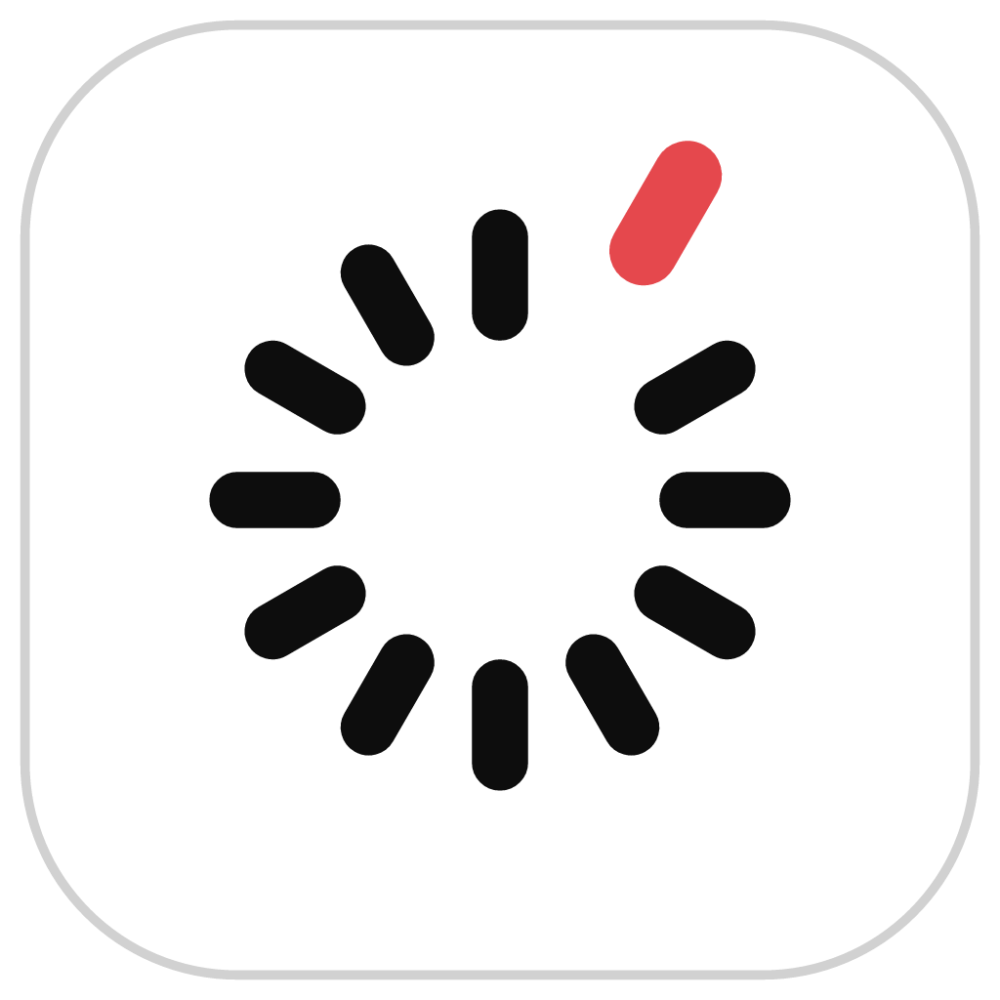

<p align="center">
  
</p>

<h1 align="center">Missing Hours</h1>

<p align="center"><strong>Find your missing hours.</strong><br>
Free, automatic time tracking for your PC. No account, no cloud, no telemetry.</p>

<p align="center">
  <a href="https://github.com/bunterWolf/Missing-Hours/releases/latest"><strong>Download for Windows</strong></a>
  · <a href="https://www.missing-hours.app">www.missing-hours.app</a>
</p>

Do you still remember on Friday what you worked on on Tuesday? Missing Hours does. It quietly records which
programs and windows you use, detects breaks and shows every day as a clear timeline, so you can fill in your
timesheet or bill your hours without ever starting a stopwatch. Everything stays on your computer.

## Features

- **Automatic**: records the active program and window title every 30 seconds. Nothing to start, stop or forget.
- **Breaks detected**: time away from your computer, including sleep mode, shows up as inactive, not as work.
- **Daily timeline**: your day in blocks of 15, 10 or 5 minutes, with your programs' icons and colors;
  consecutive identical blocks are merged.
- **Day summary**: active, inactive and tracked time at a glance.
- **Last 30 days**: browse back through previous days; older days are deleted automatically.
- **Pause with one click** when something is private.
- **Runs in the background** and can start with Windows (a setting; the Microsoft Store version starts with
  Windows by default).
- **Light, dark or automatic** appearance.
- **12 languages**: English, German, French, Spanish, Italian, Portuguese (Brazil), Dutch, Polish, Japanese,
  Korean, Simplified and Traditional Chinese; follows the Windows display language, with dates and times as
  used in your region.
- **Free**: no subscription, no ads, no in-app purchases.

## Privacy

- All data is stored only on your computer. Missing Hours sends no recorded data anywhere, neither to us nor to
  third parties.
- No account, no analytics, no telemetry.
- It goes online only for updates: the installer version asks GitHub for new versions, the Microsoft Store
  version is updated by the Store. Fonts and icons come from your computer, nothing is loaded from the internet.
- It sees which window is open, not what you type. No keystrokes, no screenshots.
- The source code is public, so you can check all of this yourself.

Details in the [privacy policy](PRIVACY.md).

## Download

- **Windows 10 and 11**: the installer `Missing-Hours-Setup-<version>-win-x64.exe` from the
  [latest release](https://github.com/bunterWolf/Missing-Hours/releases/latest). It updates itself
  automatically.
- **Windows 10 and 11 from the Microsoft Store**: [Missing Hours in the Microsoft Store](https://apps.microsoft.com/detail/9P2JR2B30DG4),
  updated by the Store.
- **macOS 10.15 and newer (experimental)**: the release also has ZIP files for Apple silicon (`arm64`) and
  Intel (`x64`). They are not signed, so macOS warns on first start, and the Mac version is less tested than
  the Windows one.

Missing Hours does not export times or create invoices; it shows you where your time went, so you can fill in
your timesheet or invoice quickly.

## Development

### Prerequisites

- Node.js (v20+)
- npm or yarn

### Setup

1. Clone the repository
   ```
   git clone https://github.com/bunterWolf/Missing-Hours.git
   cd Missing-Hours
   ```

2. Install dependencies
   ```
   npm install
   ```

3. Run in development mode
   ```
   npm run dev
   ```

### Using Mock Data

For development and testing purposes, you can use sample mock data instead of tracking real activity:

```
npm start -- --mock-data
```

When using mock data:
- The application will load sample activity data from `public/mock-data.json` instead of tracking real activity.
- No actual activity will be tracked.
- Tracking controls will be disabled.
- Mock data will not be saved to disk.

This is useful for:
- UI development without waiting for real data
- Testing functionality without actual tracking
- Presentations and demos

### Building and Releasing

#### Local Development Build

To create a development build:
```bash
npm run build
```

This will:
1. Run tests
2. Compile TypeScript
3. Bundle with webpack

#### Creating Installers

To build installers for your current platform:
```bash
npm run dist
```

Platform-specific builds:
- Windows: `npm run dist:win`
- macOS: `npm run dist:mac`

The build process will:
1. Create platform-specific installers in the `release` directory
2. Generate auto-update files (latest.yml for Windows, latest-mac.yml for macOS)
3. Create installers with the following features:
   - Windows:
     - NSIS installer (.exe)
     - Desktop and Start Menu shortcuts
     - Auto-update support
   - macOS:
     - x64 and arm64 builds
     - ZIP archive
     - Auto-update support

#### App Icon

All icon files come from the master drawings in `resources/icon-source/` (160 × 160 viewBox, each fills
its canvas): `windows-kachel.svg` (white tile for Windows and the Store), `windows-unplated-hell.svg` /
`-dunkel.svg` (ticks without a tile for the light / dark taskbar) and `kachel-hell.svg` (macOS tile on Apple's
icon grid). `kachel-dunkel.svg` and `logo-hell.svg` / `-dunkel.svg` are kept for a later dark macOS icon and the
website. Icons of 24 px and smaller get 25 % bolder ticks, up to 32 px 12 %. After changing a master, run:
```bash
npm run icons
```
and commit the generated files: `resources/icon.ico` (Windows, 16–256 px), `resources/icon.png`
(1024 px, window icon outside Windows), `resources/icon.icns` (macOS), the Microsoft Store assets in
`resources/appx/` (scale and targetsize variants, with tile and without) and the Partner Center tile icon in
`resources/store/`.

#### Store Images

`npm run store-screenshots` makes the Microsoft Store images (3840 × 2160) in every language from the real
app with a demo workday, plus the listing texts to copy (`store-screenshots/microsoft/<language>/`). The texts
live in `store/listing/`; details in `docs/MICROSOFT-STORE.md`.

#### Creating a Release

To create a new release:
```bash
npm run release
```

This will:
1. Update the version number
2. Generate the changelog
3. Create a git tag
4. Push to GitHub
5. Trigger the GitHub Actions workflow that will:
   - Run the tests and build the installers for all platforms
   - Create the GitHub Release with all files, once every platform has succeeded

See `docs/RELEASE-PROZESS.md` for details and troubleshooting.

### Beta Testing

#### Creating a Beta Release

To create a beta version for testing, from a beta branch (`beta` or `beta/*`):
```bash
npm run release:beta
```

This will:
1. Create a version with beta tag (e.g., v1.1.0-beta.0)
2. Generate a changelog
3. Push the branch and the tag
4. Trigger the GitHub Actions workflow, which builds the installers and creates a GitHub Pre-Release

See `docs/BETA-RELEASE-PROZESS.md` for the full process, including how the version number continues.

#### Setting Up Beta Testers

Beta testers need to opt-in to receive beta updates:

1. **In the app**: turn on the beta updates toggle in the settings.

2. **Manual installation**:
   - Download the beta installer from GitHub Pre-Releases
   - Install the beta version
   - Turn on the toggle to receive newer beta versions automatically

#### Beta Testing Workflow

1. **Developer**:
   - Make changes
   - Run `npm run release:beta`
   - Monitor feedback from beta testers

2. **Beta Testers**:
   - Enable beta updates
   - Use the application normally
   - Report bugs and feedback
   - Get automatic updates for new beta versions

3. **Final Release**:
   When beta testing is successful:
   - Run `npm run release`
   - This creates the final version
   - All users receive the update

#### Notes
- Beta versions are clearly marked (e.g., v1.1.0-beta.0)
- Only opted-in devices receive beta updates
- Beta releases are marked as pre-releases on GitHub
- Regular users won't see or receive beta updates
- You can release multiple beta versions (beta.1, beta.2, etc.)

## Data Storage

Activity data is stored in the app's user data directory (on Windows `%APPDATA%\missing-hours`, on macOS
`~/Library/Application Support/missing-hours`; the Microsoft Store version may use its package folder, see
[docs/MICROSOFT-STORE.md](docs/MICROSOFT-STORE.md)). The location can no longer be changed in the settings; a
folder chosen in an older version stays in use. Days older than 30 days are deleted automatically.

## License

Missing Hours is free to use for everyone, privately and at work. The source code is available under the
[PolyForm Shield License 1.0.0](LICENSE.md): you may use, study and change it, but not use it to offer a product
that competes with Missing Hours, for example by selling or publishing a copy of the app. The name
"Missing Hours" and the app icon are not licensed for other products.
